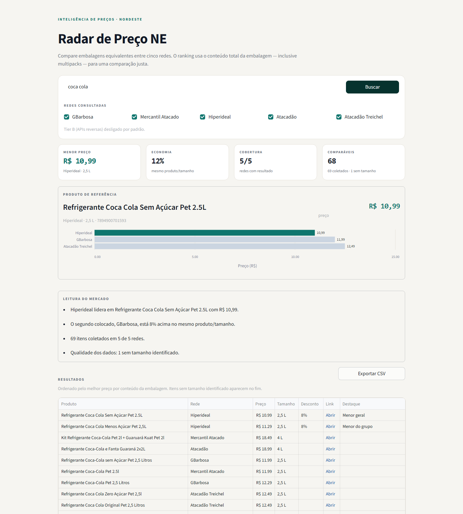
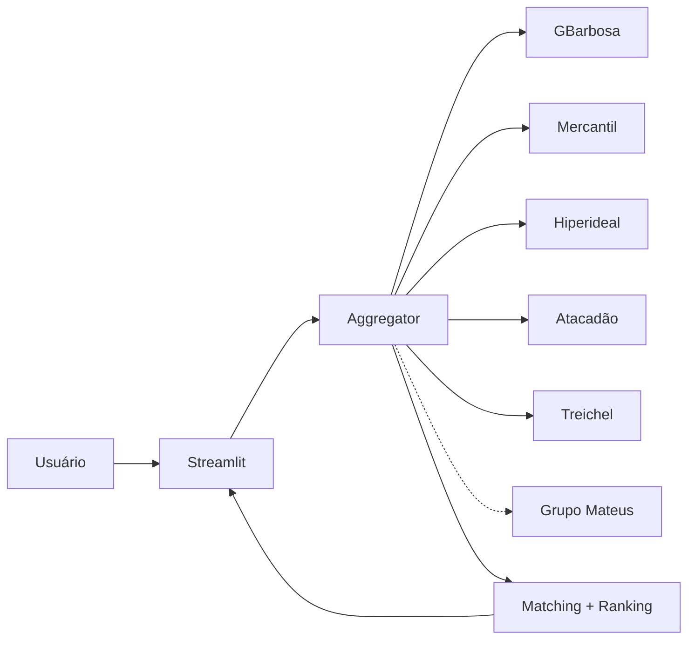

# Radar de Preço NE

Comparador de preços de supermercado para redes do Nordeste. Digite um produto
e veja onde está mais barato, com comparação justa pelo **conteúdo total da
embalagem** — inclusive quando ela é um multipack.



## Demonstração

[Assista ao vídeo em MP4](docs/assets/demo-radar-preco.mp4) — busca real por
`coca cola`, do formulário até a tabela comparativa.


## O que o painel entrega

- Busca em cinco redes com API pública VTEX.
- Ranking justo pelo conteúdo da embalagem, não pelo preço de etiqueta.
- Normalização de multipacks: `6x350ml`, `pack c/ 6`, `leve 12 pague 11`,
  `2x2L` e kits do tipo `2L + 2L`.
- Matching cross-chain por EAN exato e fallback fuzzy, sem cruzar tamanhos.
- Backfill de tamanho por EAN quando uma rede omite a quantidade.
- Leitura de mercado determinística: cobertura, economia do mesmo produto,
  itens comparáveis e qualidade dos dados.
- Exportação CSV compatível com Excel BR.

## Status das fontes

| Tier | Redes | Situação |
|---|---|---|
| A — API pública VTEX | GBarbosa, Mercantil Atacado, Hiperideal, Atacadão, Atacadão Treichel | Homologado |
| B — API reversa | Grupo Mateus; Pinheiro, Nordestão e Diniz (VipCommerce em pesquisa) | Experimental, desligado por padrão |
| C — fora do escopo | Assaí (sem catálogo público), Extra, Carrefour, GPA, Novo Atacarejo, Recibom | Não suportado na v1 |

Validação ao vivo em 09/11/2026: cinco redes VTEX, 214 itens para
`leite integral 1l`, cerca de 3,1 s em cache frio. Grupo Mateus validado na
loja Cohama (São Luís/MA) com 22 itens para `coca cola`.

## Como rodar

```bash
python -m venv .venv
.venv\Scripts\activate
pip install -r requirements-dev.txt

streamlit run app.py
```

Para rodar apenas o app:

```bash
pip install -r requirements.txt
streamlit run app.py
```

## Deploy

O caminho mais simples é o **Streamlit Community Cloud**:

1. Conecte o repositório público.
2. Selecione `app.py` como arquivo principal.
3. Mantenha `requirements.txt` na raiz.
4. Configure as variáveis de ambiente no painel.
5. Teste as cinco redes VTEX: o egress compartilhado do Streamlit Cloud pode ser
   bloqueado por alguma fonte. Se isso acontecer, remova a rede ou use um
   container próprio com egress estável. O Grupo Mateus fica atrás de
   `ENABLE_REVERSE_API`.

Não tente hospedar Streamlit no GitHub Pages; ele exige um servidor Python.

## Testes e qualidade

```bash
pytest -q
ruff check .
black --check .
```

Os testes são 100% offline: usam fixtures e monkeypatch no adapter. O CI roda a
matriz Python 3.11, 3.12 e 3.13.

## Configuração

Copie `.env.example` para `.env` ou defina as variáveis no ambiente:

| Variável | Padrão | Função |
|---|---|---|
| `ENABLE_REVERSE_API` | `false` | Liga adapters Tier B, incluindo Grupo Mateus |
| `HTTP_TIMEOUT` | `10` | Timeout por request, em segundos |
| `MAX_PAGES` | `2` | Páginas de 50 itens por rede |
| `IMPERSONATE` | `chrome` | Perfil TLS do `curl_cffi` |
| `CONTACT_EMAIL` | `contato@seudominio.com.br` | Contato no `User-Agent` |
| `MATEUS_CITY_CODE` | `2111300` | Cidade usada para resolver a loja Mateus |
| `MATEUS_LATITUDE` | `-2.5157923` | Latitude da praça Mateus |
| `MATEUS_LONGITUDE` | `-44.2452414` | Longitude da praça Mateus |
| `MATEUS_MARKET_ID` | vazio | Força uma loja específica do Mateus |

## Como funciona



1. **Coleta** — um adapter por plataforma, escolhido por
   `ChainConfig.platform` (VTEX, Mateus Mais e VipCommerce), em paralelo com
   `ThreadPoolExecutor`. Uma falha vira `ChainResult.error` e não derruba a busca.
2. **Normalização** — `units.py` extrai o conteúdo total do nome e calcula
   `preço / conteúdo` na unidade base. Pack sem quantidade explícita fica sem
   preço unitário em vez de chutar.
3. **Matching** — EAN exato primeiro; depois nome sem tamanho + mesmo
   tamanho/unidade com `rapidfuzz` (≥85 agrupa; 60–84 agrupa com aviso).
   Tamanhos diferentes nunca são agrupados.
4. **Backfill** — se uma rede não informou o tamanho, o mesmo EAN de outra rede
   preenche o dado.
5. **Ranking** — ordena por preço unitário; sem unidade vai para o fim. O painel
   destaca o menor geral, o menor por grupo e a economia do mesmo produto.
6. **UI** — Streamlit só apresenta. Nenhum HTTP é feito em `app.py`.

## Estrutura

```text
app.py                       UI e leitura de mercado
src/config.py                redes, flags, timeouts
src/models.py                Product, ChainResult
src/http.py                  curl_cffi + retry + rate limit + fallback
src/units.py                 parse de tamanho e preço unitário
src/matching.py              EAN + fuzzy + agrupamento
src/insights.py              cobertura, comparação e insights
src/aggregator.py            orquestração paralela + ranking
src/adapters/vtex.py         Tier A
src/adapters/mateus.py       Tier B (Mateus Mais)
src/adapters/vipcommerce.py  Tier B (placeholder até homologação)
tests/                       testes offline e fixtures
docs/api/                    registro de APIs descobertas
docs/assets/                 screenshot e vídeo do painel
```

## Limitações conhecidas

- Preço de catálogo público pode variar por loja/CEP.
- Não inclui preço de clube, assinatura ou fidelidade.
- A cobertura depende do catálogo público de cada rede.
- Itens sem tamanho identificado aparecem na tabela, mas ficam fora do ranking
  por unidade.
- Correspondências fuzzy são sinalizadas; confira o produto antes de comprar.
- Tier B permanece desligado por padrão; o Grupo Mateus é experimental e requer
  revisão de ToS antes de uso público.
- Assaí não expõe catálogo público de produtos; a compra online é via app ou
  parceiros de delivery.

## Compliance

- Apenas endpoints públicos e uso anônimo.
- Cache de 5 minutos e rate limit de 2 req/s por rede.
- `curl_cffi` com `impersonate` para compatibilidade TLS, **não** para derrotar
  captcha, challenge JS ou login.
- Se uma rede bloquear de forma consistente, ela deve ser removida em vez de
  contornada.
- Nenhum token, cookie ou segredo no repositório.
- Nenhum dado pessoal é armazenado.
- O Grupo Mateus usa endpoint anônimo do próprio SPA, atrás de feature flag;
  não há login, token de cliente ou contorno de proteção.

## Roadmap

- [ ] Histórico de preços e alertas.
- [ ] Comparação de cesta completa.
- [ ] Páginas públicas por produto, com SEO.
- [ ] API FastAPI e persistência em PostgreSQL.
- [ ] Homologação das fontes VipCommerce (Pinheiro, Nordestão, Diniz), se os ToS permitirem.
- [ ] Adapter do Assaí somente com API de parceiro/feed oficial.

## Licença

Código sob licença MIT. Consulte `LICENSE`.

Este projeto não é afiliado às redes citadas. Os preços e marcas pertencem aos
respectivos titulares; o catálogo público é usado apenas para comparação.
